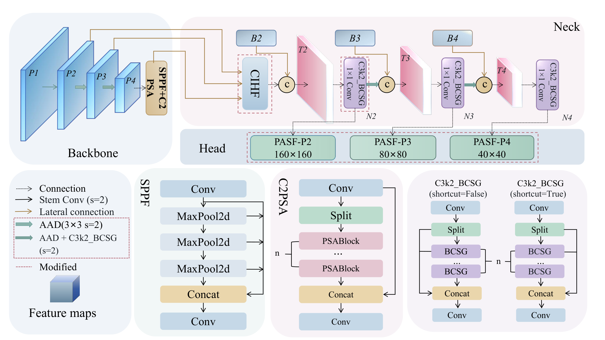
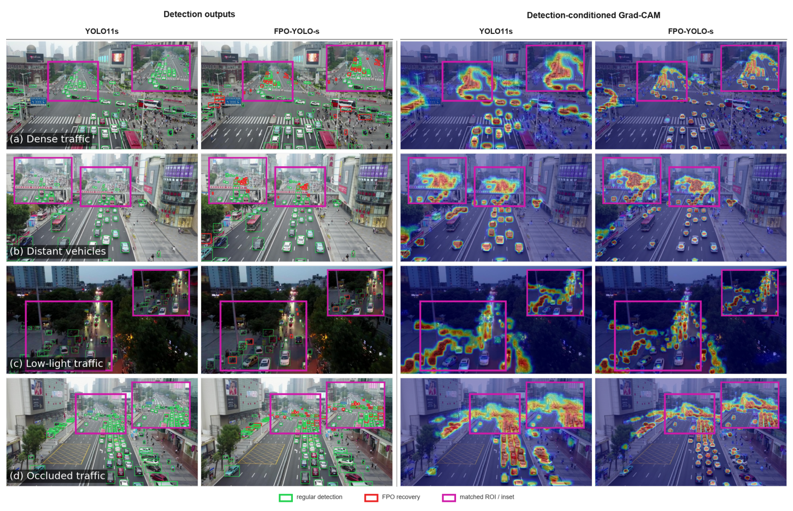

# FPO-YOLO

### 面向特征传递的无人机影像小目标检测器

[English](README.md) | [简体中文](README.zh-CN.md) · [快速开始](#快速开始) · [实验结果](#实验结果) · [复现指南](docs/fpo/reproduction.zh-CN.md) · [研究与图件演进](docs/fpo/development.zh-CN.md)

FPO-YOLO 基于 YOLO11，采用步长为 4、8、16 的 **P2–P4 预测层**，沿同一高分辨率检测路径协调局部特征调制、自适应下采样、跨层上下文聚合与逐位置尺度选择。

在 **VisDrone2019 验证集**上，FPO-YOLO-s 取得 **47.9% mAP50 / 29.2% mAP50–95**，较 YOLO11s 提高 **9.1 / 6.0 个百分点**，参数量减少 **56.2%**。使用验证集选择的同一权重，在 **test-dev** 上取得 **38.9% / 22.8%**。参数量下降伴随估算运算量增加，运行速度还取决于数据集和评估设置。

<p align="center">
  
</p>

结构图保留原有布局；尺度转换、shortcut 语义与特征命名均对照公开配置核验。[查看图件的形成过程 →](docs/fpo/development.zh-CN.md#图件如何形成)

## 更新记录

- **2026-10-09：**完善中英文文档，加入 UAVDT、AI-TOD-v2 结果及各自评估设置，整理图件制作过程。
- **2026-09-29：**发布基于 Ultralytics 8.3.237 的 FPO-YOLO 实现。
- **2026-09-08：**建立仓库。

## 方法概览

小目标可用的像素有限。引入浅层预测层能够保留更多空间信息，但这些特征仍需要语义上下文，并在预测时选择合适的尺度。四个组件分别处理这条路径中的不同运算环节：

| 组件 | 在检测路径中的作用 | 实现 |
|---|---|---|
| **BCSG：通道—空间门控瓶颈** | 以级联残差空间门控和通道门控调制局部特征；响应核组由 Scharr 核及均值核初始化，并参与后续学习。 | [fpo_bcsg.py](ultralytics/nn/modules/fpo_bcsg.py) |
| **AAD：自适应聚合下采样** | 在降低分辨率前聚合门控可变形响应，并保留并行常规下采样分支。 | [fpo_aad.py](ultralytics/nn/modules/fpo_aad.py) |
| **CIHF：跨层交互与高分辨率融合** | 通过条件交互更新中高层上下文，再将其对齐、聚合至浅层残差表征。 | [fpo_cihf.py](ultralytics/nn/modules/fpo_cihf.py) |
| **PASF：位置自适应尺度融合** | 对齐颈部输出，在各预测位置分别选择不同尺度的贡献。 | [fpo_pasf.py](ultralytics/nn/modules/fpo_pasf.py) |

组件组合及移除消融支持它们在共同高分辨率路径中的互补作用。[消融结果与方法承接关系 →](docs/fpo/development.zh-CN.md)

## 实验结果

以下精度单位均为百分比。mAP50–95 在 IoU 0.50:0.05:0.95 上求平均。**验证集和测试集结果分别列出。**

### VisDrone2019-DET

| 模型 | Val mAP50 | Val mAP50–95 | Test-dev mAP50 | Test-dev mAP50–95 | 参数量（M） | GFLOPs |
|---|---:|---:|---:|---:|---:|---:|
| YOLO11s | 38.8 | 23.2 | 31.4 | 18.0 | 9.43 | 21.6 |
| FPO-YOLO-n | 40.9 | 24.7 | 33.1 | 19.2 | 1.34 | 13.5 |
| FPO-YOLO-s | 47.9 | 29.2 | 38.9 | 22.8 | 4.13 | 36.5 |
| FPO-YOLO-m | 51.5 | 31.8 | 41.1 | 24.3 | 14.84 | 121.0 |
| FPO-YOLO-l | 52.2 | 32.4 | 41.4 | 24.5 | 16.50 | 138.0 |

保留官方 train/val/test-dev 划分，test-dev 使用验证集选择的权重。GFLOPs 为 640 像素输入下的分析器估算值，不能直接等同于硬件运行时间。配置另支持 `x` 尺度，本页不汇报未提供的 `x` 实验结果。

### UAVDT：按完整序列划分的验证集

| 模型 | Val mAP50 | Val mAP50–95 |
|---|---:|---:|
| YOLO11n | 37.0 | 18.7 |
| FPO-YOLO-n | 44.0 | 23.5 |
| YOLO11s | 44.4 | 24.9 |
| FPO-YOLO-s | 52.0 | 28.3 |

自定义划分由 **24 个训练序列 / 6 个验证序列**组成，共 **20,533 / 3,610 张图像**。将官方训练序列名称排序，以随机种子 42 选取完整验证序列；官方测试部分不参与该划分。本表汇报的是**验证集结果**。平均精度提升仍伴随部分类别的定位权衡，以及该数据集上的实测延迟增加。

### AI-TOD-v2：官方测试集

| 模型 | Test mAP50 | Test mAP50–95 |
|---|---:|---:|
| YOLO11n | 34.4 | 14.8 |
| FPO-YOLO-n | 43.1 | 19.5 |
| YOLO11s | 45.5 | 19.9 |
| FPO-YOLO-s | 54.4 | 25.0 |

保留公开的 **11,214 / 2,804 / 14,018** train/val/test 划分。仅以 `train` 训练，使用 `val` 选择权重，以 FP32、`max_det=300` 在 `test` 上评估。上述结果采用相同的 Ultralytics 评估器，不是官方 tiny 尺寸分组 COCO 评估的重实现。UAVDT 和 AI-TOD-v2 均**分别训练模型**，不表示 VisDrone 权重的零样本跨域迁移。[各数据集复现设置 →](docs/fpo/reproduction.zh-CN.md#数据集与划分)

## 定性比较

<p align="center">
  
</p>

四行图像分别比较车辆区域中的检测结果与检测条件 Grad-CAM。每个区域内，两模型的 CAM 使用同一组真实车辆作为条件。这些图用于展示预测差异，不能代替组件作用的定量验证。图像来自 VisDrone，检测输出和可视化由本项目生成。[可视化制作方法 →](docs/fpo/development.zh-CN.md#检测与响应可视化)

## 快速开始

### 1. 安装本仓库与编译算子

参考环境为 **Python 3.10、PyTorch 2.4.1、CUDA 11.8、Ultralytics 8.3.237**。先安装适合本机的 PyTorch/CUDA 组合，再在独立环境中执行：

```bash
git clone https://github.com/Azure-127031/FPO-yolo.git FPO-YOLO
cd FPO-YOLO
python -m pip install -e .
python -m pip install -r requirements-fpo.txt
```

AAD 依赖**包含编译算子的 MMCV**，需要 `mmcv.ops.ModulatedDeformConv2d`，`mmcv-lite` 无法替代。MMCV 应与 PyTorch、CUDA 匹配；没有对应 wheel 时，按 [MMCV 官方安装说明](https://mmcv.readthedocs.io/en/latest/get_started/installation.html)构建。检查实际导入的是当前仓库：

```bash
python -c "import ultralytics; print(ultralytics.__version__); print(ultralytics.__file__)"
python -c "from mmcv.ops import ModulatedDeformConv2d; print('MMCV ops import OK')"
python scripts/check_model.py --scale s
```

导入检查确认算子可用，`check_model.py` 用于构建结构；二者均不能替代实际 CUDA 训练验证。

### 2. 准备 YOLO 格式数据

修改 [configs/visdrone.yaml](configs/visdrone.yaml) 的 `path`，指向数据根目录：

```text
VisDrone2019/
├── images/
│   ├── train/
│   ├── val/
│   └── test-dev/
└── labels/
    ├── train/
    ├── val/
    └── test-dev/
```

每张图像对应同名标签文件，每行格式为 `class_id x_center y_center width height`，坐标归一化至 `[0, 1]`。类别顺序须与 YAML 一致。请从数据集作者处获取数据；当前版本不分发完整数据集或转换工具。[划分及标注要求 →](docs/fpo/reproduction.zh-CN.md#数据集与划分)

### 3. 从随机初始化训练

```bash
python scripts/train.py --scale s --data configs/visdrone.yaml --device 0
```

公开训练入口从 YAML 初始化，使用 `imgsz=640`、batch 16、最多 200 轮、SGD、patience 100、AMP、`close_mosaic=10`，默认 seed 为 0。该 seed 是发布版本默认设置，不追溯断言所有历史实验均使用了相同种子。此入口对应 VisDrone/UAVDT 设置；**AI-TOD-v2 应使用单独的设置**。

### 4. 评估验证集选择的权重

```bash
python scripts/val.py --weights runs/fpo_yolo/fpo_yolo_s_e200/weights/best.pt --data configs/visdrone.yaml --device 0 --split val
python scripts/val.py --weights runs/fpo_yolo/fpo_yolo_s_e200/weights/best.pt --data configs/visdrone.yaml --device 0 --split test --save-json
```

该 YAML 中 `--split test` 对应 `images/test-dev`。若 Ultralytics 为运行目录添加后缀，应使用实际路径。测试前固定权重选择，不用 `last.pt` 替换 `best.pt`。

`scripts/val.py` 使用 FP16 和 batch 16；AI-TOD-v2 的 FP32/batch-15 设置见[对应 API 示例](docs/fpo/reproduction.zh-CN.md#ai-tod-v2-训练与测试)。

## 研究与图件演进

项目从高分辨率预测路径出发，逐步开展组件对照、多数据集评估与图文实现核对。详细记录包括：

- 局部门控、采样、上下文聚合和预测端选择如何分工；
- 如何对照代码核验原始 PowerPoint 图，在保留形状与走线的基础上修订；
- 如何分别替换模块填色，而非整页叠加色罩；
- 如何制作实验图、子图编号、检测结果及 Grad-CAM 面板。

**[阅读中文研究与图件演进记录](docs/fpo/development.zh-CN.md) · [Read in English](docs/fpo/development.md)**

## 仓库结构

| 路径 | 内容 |
|---|---|
| [ultralytics/cfg/models/11/yolo11-fpo.yaml](ultralytics/cfg/models/11/yolo11-fpo.yaml) | 共用结构及 n/s/m/l/x 尺度定义 |
| [ultralytics/nn/modules](ultralytics/nn/modules) | FPO 模块与继承的 Ultralytics 组件 |
| [scripts](scripts) | 结构检查、训练和评估入口 |
| [configs](configs) | VisDrone、UAVDT 数据模板 |
| [docs/fpo](docs/fpo) | 复现指南、演进记录和图件资源 |

## 发布内容与适用范围

当前版本包含实现代码、结构与数据配置、运行入口和文档，**不包含训练权重及完整原始实验日志**。展示图件是已有研究图的导出资源，不是可由权重重新生成全部可视化的完整工具包。

自定义可变形算子需要兼容的编译环境。本版本不据此声称已验证 ONNX/TensorRT 导出、部署速度或任意依赖版本组合。FPO-YOLO 减少了参数量，但不代表各尺度 GFLOPs 均下降，或每个类别指标均提升。

## 致谢、引用与许可

代码基于 [Ultralytics](https://github.com/ultralytics/ultralytics) 和 [MMCV](https://github.com/open-mmlab/mmcv)。AAD 使用修改后的 DCNv2 采样，CIHF 承接 SBA 式交互，PASF 采用 ASFF 式空间尺度加权与坐标注意力式方向细化。[演进记录](docs/fpo/development.zh-CN.md#方法承接与改造)区分这些来源与本项目的具体修改。

对应论文题为 **FPO-YOLO: A Feature Propagation-Oriented Detector for Small Objects in UAV Imagery**。当前发布版本未提供正式发表元数据；正式引用信息公布前，可引用本仓库并记录实验使用的 commit。

仓库遵循 [AGPL-3.0 许可](LICENSE)，请保留上游声明。提交问题时请附 commit、环境版本、数据 YAML、运行命令及完整报错，不附私人数据或凭据。
