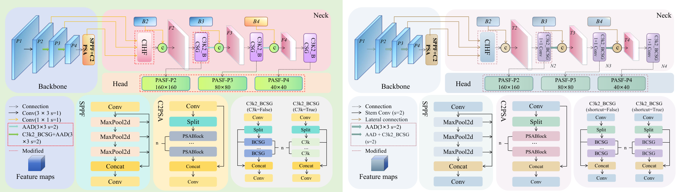
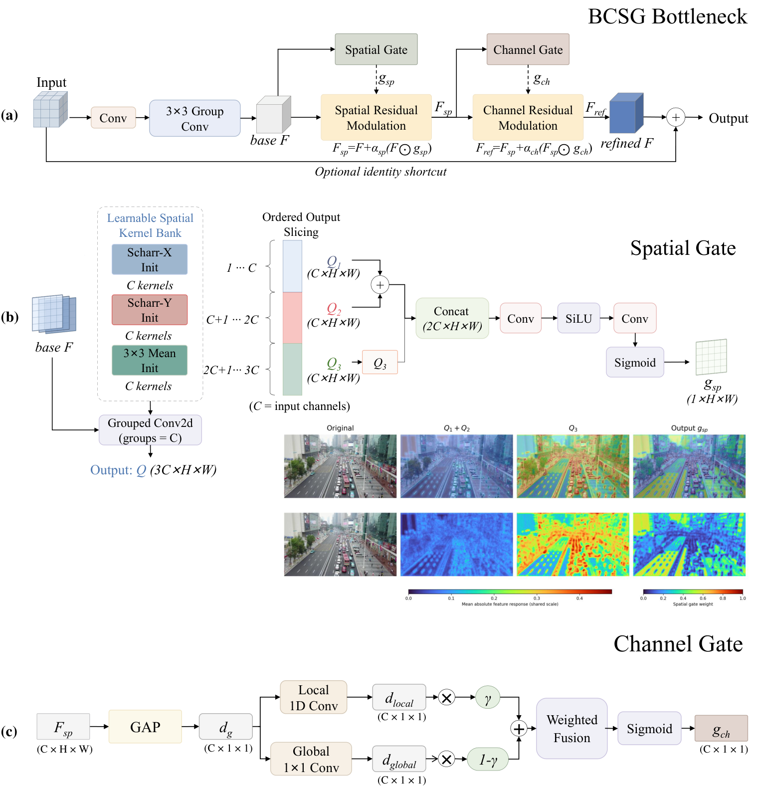
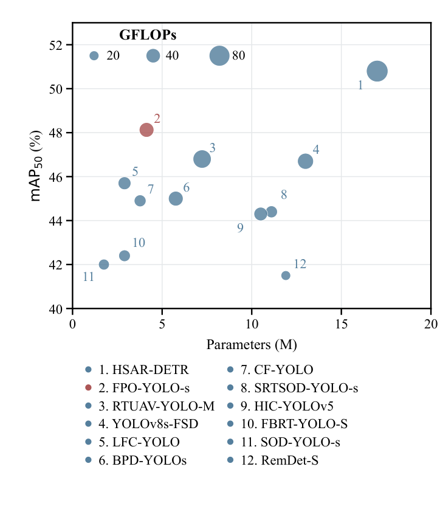
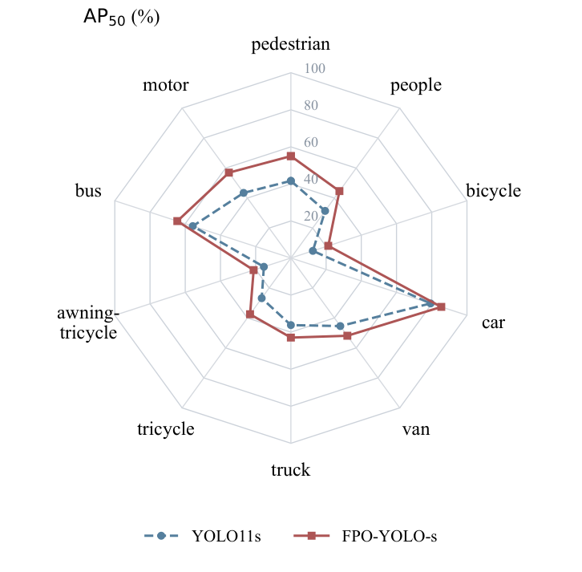
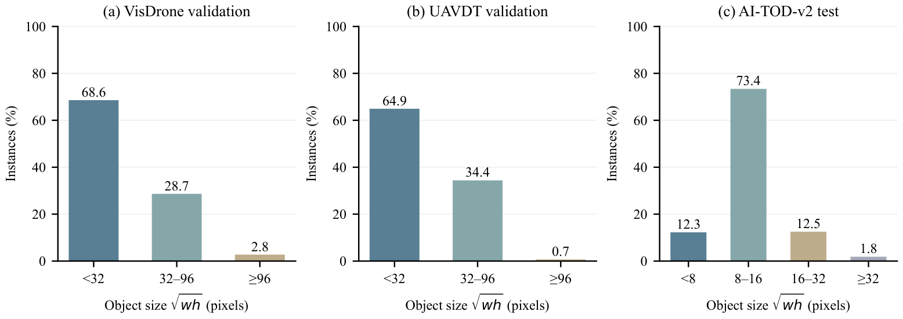

# Research and figure development

[GitHub repository](https://github.com/Azure-127031/FPO-yolo) · [Project home](../../README.md) · [简体中文](development.zh-CN.md) · [Code design](architecture.md) · [Experiments](experiments.md) · [Reproduction guide](reproduction.md)

FPO-YOLO developed through component drawings, a complete detection path, VisDrone experiments, additional-dataset evaluation, and a public implementation. This page connects the retained materials: dated figure versions, manuscript checks against code and results, and the cropping, assembly, semantic corrections, and palette revisions that brought PowerPoint drawings into the paper and repository.

[Timeline](#documented-milestones) · [Development narrative](#how-the-work-developed) · [Design and ablations](#from-a-shallow-prediction-level-to-a-coordinated-path) · [Figure workflow](#figure-development) · [Detection visualization](#detection-and-response-visualization)

This page focuses on research progression and figure development. See [code design](architecture.md) for component computations and [experiment history](experiments.md) for the complete comparison tables and training process. Key ablations remain below to explain how the method developed.

## Documented milestones

The drawing archive predates the GitHub repository. This timeline brings together figure preparation, manuscript revisions, experiments, and public releases so that each stage has a concrete outcome.

**How to read the dates:** “Figure timestamp” denotes the modification time retained on a source file, not the date a model was invented or an experiment finished. Revision and experiment entries come from dated records; repository entries link to commits. For current numbers and procedures, use the second-edition README and reproduction guide.

| Date | Stage | Work and retained outcome | Date evidence |
|---|---|---|---|
| 2026-03-03 | Baseline drawing | Retained a YOLO11 structure PDF as a reference for explaining later architectural changes. | Figure timestamp |
| 2026-03-09–03-17 | Individual module drawings | Saved BCSG overview, AAD, SBA, ASFF, and Scharr-gate PPT/PDF files. These explain individual operations and should not be treated as a complete description of the current release. | Figure timestamps |
| 2026-03-30 | Dataset illustrations | Saved VisDrone distribution and selected-scene illustrations for dataset statistics and representative aerial scenes. | Figure timestamps |
| 2026-06-12–07-15 | Editable figure iterations | Retained later PowerPoint versions for AAD, ASFF, and the BCSG spatial branch. Module diagrams continued to be maintained as editable objects. | Figure timestamps |
| 2026-08-04–08-11 | Overview and component figures | Saved BCSG drawings and PPTX/PDF versions of the FPO overview, YOLO11s baseline, AAD, and PASF, providing both an overall path and component detail. | Figure timestamps |
| 2026-09-03 | Initial manuscript materials | Retained the initial manuscript, code document, and CIHF/BCSG figure versions for subsequent checks across text, implementation, and figures. | Manuscript and figure records |
| 2026-09-04–09-06 | Experiment-section revisions | Updated tables and analysis against validation records; separated component increments, combination effects, computational cost, and class-wise performance before another prose revision. | Dated chapter-four revision notes |
| 2026-09-08 | Repository creation | Created the repository in [`366a29d`](https://github.com/Azure-127031/FPO-yolo/commit/366a29d). Manuscript work in this period also checked method descriptions, tables, class distributions, and class-wise AP plots. | Commit and revision records |
| 2026-09-09–09-10 | Method and experiment checks | Continued chapter-level comparisons against implementation and literature; added the UAVDT experiment section to the manuscript. | Dated chapter sources |
| 2026-09-11–09-16 | Gate visualization and full-paper checks | Retained spatial-gate implementation/visualization scripts, integrated manuscript revisions, updated validation/test-dev tables, and refined gate and dataset figures. | Script versions and revision directories |
| 2026-09-18–09-19 | English and journal-layout drafts | Prepared English and CAS double-column drafts; checked tables, captions, references, and complexity conventions, with separate UAVDT protocol notes. | Layout, table, and protocol records |
| 2026-09-29 | Implementation release and BCSG assembly | Released the implementation in [`9016224`](https://github.com/Azure-127031/FPO-yolo/commit/9016224). Figure work corrected BCSG formulas and assembled bottleneck/spatial/channel panels at a common visible width. | Commit and figure assembly sources |
| 2026-10-01–10-02 | Supplementary-experiment protocol review | Reviewed UAVDT sequence coverage, internal validation versus official testing, and literature metrics; retained diagnostics and decisions. | Experiment review records |
| 2026-10-03 | AI-TOD-v2 preparation | Completed download/content audits and checked the fixed splits; recorded box conversion, empty images, invalid boxes, final code snapshots, and baseline training records. | Dataset and experiment log |
| 2026-10-05 | Supplementary training | Resumed FPO-YOLO-s from its saved training state and started the corresponding FPO-YOLO-n run, checking code snapshots, scales, settings, and resume provenance. | Dated training records |
| 2026-10-06 | AI-TOD-v2 training and testing completed | Verified completion of YOLO11n/s and FPO-YOLO-n/s training; evaluated the fixed test split with validation-selected checkpoints and saved the results/settings. | Completion and test-summary records |
| 2026-10-07 | Results and annotated feedback | Incorporated AI-TOD-v2 testing and detection-conditioned visualization, then revised the problem–design–evidence connection, formulas, abbreviations, captions, and references against peer annotations. | Supplementary manuscript and feedback records |
| 2026-10-08 | Figure semantics and appearance | Checked strides, feature names, and shortcuts; compared redraws with local revisions, retained the original shapes/routes, and recolored individual modules. Organized the accuracy–complexity plot by mAP50. | Figure revisions and geometry checks |
| 2026-10-09 | Second-edition documentation | Prepared English/Chinese manuscript versions with repository links and released the second-edition documentation in [`d367e8e`](https://github.com/Azure-127031/FPO-yolo/commit/d367e8e). This expanded history builds on that release using existing code, assets, and results. | Commit and bilingual delivery records |
| 2026-10-11 | Checkpoint evaluation and result synchronization | Evaluated existing checkpoints with AP75 and COCO size AP; synchronized the manuscript, numerical snapshot, and figures without new training or splits. | Evaluation records and current manuscript |

## How the work developed

### Explain individual computations, then connect the path

The early drawing archive contains separate views of downsampling, local gates, cross-level interaction, and scale fusion. PowerPoint supported changes to individual blocks, arrows, tensor illustrations, and formulas; PDF exports supported manuscript preparation. By August, the retained materials included both a network overview and component diagrams, allowing a reader to follow the overall data flow before examining an operation in detail.

Some source drawings still carry SBA or ASFF names. They document antecedents in the drawing and design process, but a filename alone cannot date the final architecture. Later manuscript and repository documentation distinguish these sources, the implemented modifications, and the current code entry points; see [Design lineage](#design-lineage).

### Connect manuscript statements to code and result tables

September revisions brought together the initial manuscript, code document, and validation logs. Checks became concrete: whether a drawn transition actually reduces resolution, whether an explanation follows the implemented computation, whether validation and test-dev results remain separate, and whether component gains are accompanied by their computational costs.

Chapter four underwent section-level revision, a complete review, and another prose pass. Dataset illustrations explain the data, class-wise AP plots analyze class performance, and component tables provide evidence for architectural comparisons. Later checks also updated baseline and complexity conventions. **The history records that process; current numbers remain in the [second-edition result tables](../../README.md#results).**

### Move from a Chinese draft to a double-column manuscript

By mid-September, revisions addressed the complete manuscript rather than isolated chapters. Related work, methods, ablations, and additional datasets needed a connected argument. English and CAS double-column drafts followed, with checks on figure widths, table notes, subfigure labels, and cross-references. A drawing also had to remain legible at its actual column width.

The three BCSG source panels had different page margins, so equal page widths did not align their visible contents. The September 29 assembly first cropped the content, then used LaTeX/TikZ to place the panels at a common visible width and align their labels. This improved manuscript readability while retaining the computation being illustrated.

### Retain the dataset and evaluation process

The UAVDT work produced several protocol reviews: how complete sequences were divided, how internal validation differed from official testing, and whether image counts and metrics from other papers described comparable experiments. The early-October diagnostics continued this work. Public documentation describes the split and evaluator actually used.

The AI-TOD-v2 log connects download, auditing, annotation conversion, training, resumption, and testing. Data and baseline records were checked on October 3; FPO training progressed on October 5; four completed runs and their fixed-split tests were verified on October 6. Results entered the manuscript on October 7. This gives a result row a traceable split and checkpoint-selection procedure rather than only a final score.

### Refine the original visual language

October figure work included local overlays, a vector redraw, and a return to local revision of the original. The selected version preserves the established shapes, feature planes, and connector routes, corrects labels and computational semantics, and changes colors at the module level. Its geometry checks retain the original 104 vector paths and feature-plane placements.

Repeated objects such as Conv, Split, BCSG, and Concat receive consistent colors, with text and arrows carrying the reading sequence. Side-by-side exports check the visual change. Experimental plots remain tied to their data tables: axis or legend revisions also require checking model identifiers and values. The final assets and production methods appear below.

### Turn the material into an open research record

The repository was created on September 8, the implementation released on September 29, and bilingual second-edition documentation published on October 9. The README provides the model, results, and entry points; the reproduction guide explains data and environment settings; this page follows the research and figure work. The expanded history makes the earlier stages visible while retaining the existing second-edition implementation and results.

## From a shallow prediction level to a coordinated path

The starting point is the limited spatial support of aerial small objects. Moving prediction from P3–P5 to P2–P4 retains a finer grid, but does not by itself provide the shallow features with enough context. The structural comparisons distinguish these steps:

| Configuration | VisDrone val mAP50 (%) | mAP50–95 (%) |
|---|---:|---:|
| YOLO11s | 38.8 | 23.2 |
| P2–P4 prediction | 42.8 | 25.9 |
| Shallow aggregation without cross-level interaction | 43.1 | 26.1 |
| Complete CIHF reference | 43.9 | 26.6 |

CIHF establishes the common high-resolution reference. The remaining components address operations that its cross-level aggregation does not replace:

1. **BCSG modifies the local representation.** A learnable response bank drives spatial modulation, followed by channel modulation. It does not change the downsampling grid.
2. **AAD modifies the scale transition.** Deformable aggregation operates before resolution reduction, alongside regular sampling. It addresses a different operation from local residual gating.
3. **PASF modifies prediction-side scale selection.** CIHF's scale/channel aggregation weights are shared across spatial locations; PASF instead calculates location-dependent weights for aligned neck features at each prediction level.

The resulting model connects feature formation, resolution change, context exchange, and prediction-side selection on the same path. The rationale is examined through comparisons rather than inferred from the names of the modules.

## What the component combinations show

The following configurations use the same CIHF reference and the same VisDrone training protocol:

| Enabled components | mAP50 (%) | mAP50–95 (%) |
|---|---:|---:|
| CIHF | 43.9 | 26.6 |
| CIHF + AAD | 44.6 | 27.0 |
| CIHF + BCSG | 45.6 | 27.6 |
| CIHF + PASF | 45.0 | 27.3 |
| CIHF + AAD + BCSG | 46.5 | 28.3 |
| CIHF + BCSG + PASF | 46.6 | 28.6 |
| CIHF + AAD + PASF | 46.4 | 28.3 |
| CIHF + AAD + BCSG + PASF | 48.1 | 29.2 |

Relative to CIHF, the isolated mAP50–95 improvements are 0.4, 1.0, and 0.7 points. Their sum is 2.1 points, whereas the full model gains 2.6 points. Removing AAD, BCSG, or PASF from the full configuration reduces mAP50–95 by 0.6, 0.9, and 0.9 points, respectively. These observations support non-additive, complementary effects **within this tested configuration**. They do not constitute multi-seed significance testing or a full four-factor interaction analysis.

## Design lineage

The code retains established operators where appropriate and modifies how they are used in this high-resolution detector:

| Component | Antecedent | Implemented distinction |
|---|---|---|
| BCSG | Group convolution, Scharr/mean initialization, spatial and channel gating | A learnable response bank drives cascaded residual gates in the bottleneck. Initialization describes the starting kernels, not fixed derivatives throughout training. |
| AAD | Modulated deformable convolution (DCNv2) | Separately predicted offsets, bounded sample-wise offset modulation, deformable aggregation before pooling, and a parallel regular branch with fusion. The historical class name `MDCv3` does **not** identify the DCNv3 operator. |
| CIHF | SBA interaction from DuAT | Conditional transformations of the interacting middle/deep features, followed by aligned scale/channel aggregation onto the shallow residual path. |
| PASF | ASFF and coordinate attention | Scale alignment and spatial Softmax weighting are retained; the released head adds its weight-generation, normalization, temperature, and directional residual-refinement design. |

These are architectural modifications and their coordinated use, rather than claims that all underlying operators were invented here. Refer to the module files linked in the [README](../../README.md#method) for the implementation.

## Figure development

### Architecture: revise the original, check against code

The architecture drawing starts from the project's original **PowerPoint diagram exported to PDF**. Revisions preserve the established layout, block shapes, feature-plane geometry, and connector routes. The implementation—not the visual convenience of a schematic—determines the labels and scale changes.

The code checks cover:

- **Resolution transitions.** The initial stem is a 3×3 convolution with stride 2; the subsequent AAD stages reduce resolution by 2. A stride-1 legend must not describe a reduction in spatial dimensions.
- **Feature names and shapes.** Backbone features use B2/B3/B4; neck outputs use N2/N3/N4. For the `s` configuration and a 640×640 input, backbone outputs are 128×160×160, 256×80×80, and 256×40×40; neck outputs are 64×160×160, 128×80×80, and 256×40×40, respectively. Shapes exclude the batch dimension.
- **Container semantics.** In `C3k2_BCSG`, the Boolean argument controls each internal BCSG shortcut. The released container does not switch between C3k=False/True structural branches.
- **Head connections.** The three neck features feed the released `Detect_PASF_Final` head, producing P2/P3/P4 predictions.

The revised palette replaces individual fills and relevant gradient endpoints. Convolution blocks use muted blue, splitting uses teal, BCSG containers use lavender, concatenation uses warm sand, and distinct attention/fusion blocks retain consistent color identities. This is an object-level color revision, not an overlay across the whole page.

*Palette revision of the original diagram. The older panel is retained only to document visual development; use the final architecture below for the released structure.*

[Final overview PDF](assets/architecture.pdf) · [Browser preview](assets/architecture.png)

### BCSG: assemble the computation, not just three named boxes

The BCSG figure combines three cropped source panels: the bottleneck, the spatial gate, and the channel gate. **LaTeX/TikZ** places the exported panels at a shared visible width and aligns labels (a), (b), and (c) with their content. The drawing shows residual modulation, ordered output slicing of the response bank, and local/global channel processing.

The response-bank illustration follows the code's contiguous output-channel partitions. The diagram should not be read as a separate Scharr-X/Scharr-Y pair independently applied to every channel. [BCSG figure PDF](assets/bcsg.pdf)

### Experimental plots: tie the picture to the result table

Quantitative plots are prepared with **Python/Matplotlib** and exported to PDF for the manuscript. Class-distribution counts are preserved, as is the source bounding-box size-density panel. Layout changes do not generate a replacement distribution.

The accuracy–complexity bubble plot uses **parameters on the horizontal axis, mAP50 on the vertical axis, and GFLOPs as bubble area**. Model numbering and legend order follow the mAP50 ordering. Points retain their reported values; a layout change does not alter an experimental result. Results taken from other papers remain reported comparisons with different possible training conditions.

[Plot PDF](assets/accuracy-complexity.pdf)

### AP and object-size updates

The current plots and tables use the [October 11 result snapshot](data/reported-results.json). VisDrone class-wise AP uses the primary YOLO11s/FPO-YOLO-s checkpoints; the qualitative asset is synchronized to this same comparison. Size distributions use original-image box dimensions and retain the three fixed evaluation splits.

## Detection and response visualization

Detection panels are generated from actual model predictions, using the same region of interest to compare YOLO11s and FPO-YOLO-s. The Grad-CAM target is conditioned on the **same annotated vehicle group within each region**:

1. Select decoded candidate predictions near each target vehicle and use its class score.
2. Backpropagate the sum of the selected scores through all three classification branches.
3. Obtain channel weights by spatially averaging the activation gradients and apply ReLU to the weighted activation sum.
4. Resize the level CAMs, sum them, remove letterbox padding, and map the result back to the source image.
5. Normalize the resulting CAM for display and assemble paired detection/response panels using a consistent layout.

This target construction retains each detector's actual prediction levels, including FPO-YOLO's P2 branch. A display-normalized heatmap is not an absolute response-magnitude comparison across models. The images show selected scenes and should be interpreted together with aggregate and class-wise results.

[Qualitative figure PDF](assets/qualitative.pdf) · [Browser preview](assets/qualitative.png)

## Figure assets and reproducibility

| Asset | Source workflow | Released form |
|---|---|---|
| Architecture | Original PowerPoint → PDF; code/label checks and object-level color revision | PDF + PNG |
| BCSG | Exported panels → tight crop → LaTeX/TikZ assembly | PDF + PNG |
| Accuracy–complexity | Result table → Matplotlib | PDF + PNG |
| Qualitative comparison | Predictions and detection-conditioned Grad-CAM → Matplotlib panel assembly | PDF + PNG |
| Palette evolution | Before/after exports of the original architecture | PNG |

PNG files support GitHub viewing; PDFs retain the manuscript exports. Exported PDFs can contain embedded image panels and are not all pure vector drawings. The repository does not yet include all source slide files, historical visualization scripts, model checkpoints, or dataset images required to recompute these assets.

The development principle is to revise structure where the code demands it, revise appearance at the individual-object level, and keep the underlying evidence unchanged.
